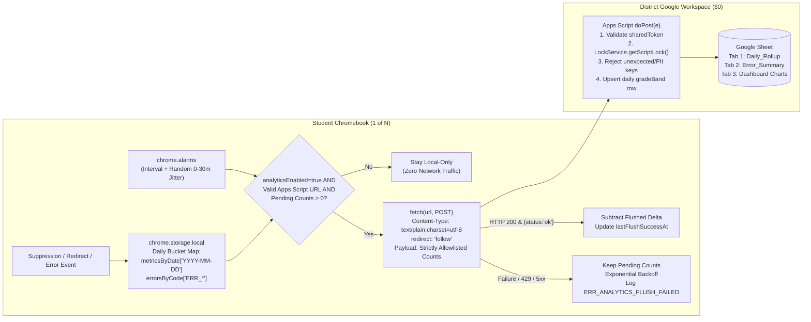

<!-- ARCHIVE — reference only. Analytics sections of the docs @ commit 989c95a -->
## From docs/04-ADMIN-DEPLOYMENT-RUNBOOK.md

## Step 4 (Optional): Enable \$0 District-Owned Google Sheets Analytics (5 Minutes)

By default (`analyticsEnabled: false`), all counters stay locally on each Chromebook with zero network traffic. To see district-wide totals (AI Overviews hidden, AI Mode attempts redirected, errors by grade band) inside your own Google Workspace:

1. Create a new **Google Sheet** in a district IT folder (e.g., `Search Guard District Analytics`).
2. Open **Extensions → Apps Script**.
3. Delete the placeholder code and paste `templates/apps-script/Code.gs` from the repository.
4. *(Optional)* Set a non-secret `SHARED_TOKEN` string at the top of `Code.gs` (e.g., `"district-sg-2026"`).
5. Click **Deploy → New deployment → Select type: Web app**:
   * **Execute as:** `Me` (service/IT account)
   * **Who has access:** `Anyone` *(required so managed Chromebooks can POST anonymous aggregate counts without interactive OAuth popups)*
6. Click **Deploy**, authorize the script to edit its own spreadsheet, and copy the resulting Web App URL (`https://script.google.com/macros/s/.../exec`).
7. Add these fields to each grade-band OU's **Policy for extensions** JSON:
   ```json
   "analyticsEnabled": { "Value": true },
   "analyticsEndpointUrl": { "Value": "https://script.google.com/macros/s/YOUR_DEPLOYMENT_ID/exec" },
   "analyticsSharedToken": { "Value": "district-sg-2026" },
   "analyticsFlushIntervalMinutes": { "Value": 240 }
   ```
8. **Zero PII Guarantee:** Your Google Sheet receives **only** daily aggregate rows (`Date`, `GradeBand`, `ExtensionVersion`, integer block counts, integer error counts)—never student names, emails, device IDs, or search queries.

---

## From PRIVACY.md

## Optional District-Owned Analytics (Disabled by Default)
By default, **zero data ever leaves the device**. If a school district administrator explicitly enables `analyticsEnabled` and configures an `analyticsEndpointUrl` pointing to a **Google Apps Script Web App hosted inside the school district's own Google Workspace**, the extension periodically sends strictly anonymous daily aggregate counters:
- Schema version and extension version
- Configured Organizational Unit grade-band label (e.g., `K-2`, `3-5`, `6-8`, `9-12`)
- Calendar date bucket (`YYYY-MM-DD`, no finer timestamps)
- Aggregate integer counts of suppressed AI elements, redirected AI Mode navigations, and software error codes

This optional telemetry contains **no** student names, email addresses, Chrome profile IDs, device serial numbers, cookies, search terms, visited URLs, or third-party trackers. It is transmitted directly from the district's Chromebook to the district's own Google Workspace spreadsheet and is never received by RaiseMark AI or any third party.

## From docs/02-ARCHITECTURE.md

## 5. Zero-PII, Zero-Cost District Analytics Data Flow



### Privacy & Thundering-Herd Safeguards
1. **Strict Payload Schema Whitelist:** No student email, no username, no browser fingerprint, no device ID, no IP stored in Sheets, no search query strings, no exact event timestamps—only `dateBucket` (`YYYY-MM-DD`), `gradeBand`, `extensionVersion`, and integer counters.
2. **Endpoint Allowlist Regex:** Service worker refuses to POST to any URL that does not strictly match `^https://script\.google\.com/macros/s/[A-Za-z0-9_-]+/exec$`, logging `ERR_ANALYTICS_ENDPOINT_INVALID`.
3. **Thundering-Herd Protection:** A 10,000-Chromebook district booting at 8:00 AM would overwhelm Apps Script's ~30 concurrent execution ceiling if synced simultaneously. Our scheduler adds **uniform random jitter (0–30 minutes)** on every alarm cycle, caps retries with exponential backoff (up to 24h), and uses `LockService.getScriptLock().waitLock(15000)` in `Code.gs`.
4. **Atomic Delta Accounting:** When flushing, the service worker snapshots the pending counters (`snapshot`), sends `snapshot`, and upon HTTP 200 subtracts `snapshot` from current `chrome.storage.local` totals (never blindly zeroing, so events occurring during the HTTP round-trip are never lost!).

---

## From docs/03-DEVELOPER-SPEC.md

### 8.2 Zero-PII Analytics & Jittered Flush (`src/background/analytics.ts`)
* **Alarm Scheduling:** When `policy.analyticsEnabled && policy.analyticsEndpointUrl`, schedule `'rmsg-analytics-flush'` with `delayInMinutes = policy.analyticsFlushIntervalMinutes + Math.floor(Math.random() * 31)` (0–30 min uniform jitter to prevent district-wide 8:00 AM thundering herds).
* **Strict Validation:** Validate `policy.analyticsEndpointUrl` against `APPS_SCRIPT_URL_REGEX`. If invalid, log `ERR_ANALYTICS_ENDPOINT_INVALID` and abort without making any network request.
* **Flush Execution:**
  * Snapshot all date buckets in `pendingMetricsByDate` (and `pendingErrorsByCode`) where total count > 0.
  * For each date bucket, build strictly allowlisted `AnalyticsFlushPayload` (verify via runtime sanitizer that ZERO unexpected keys exist!).
  * `fetch(endpointUrl, { method: 'POST', headers: { 'Content-Type': 'text/plain;charset=utf-8' }, redirect: 'follow', body: JSON.stringify(payload) })` with a 15-second `AbortController` timeout.
  * Verify `response.ok` AND JSON body `{ status: 'ok' }`.
  * On success: subtract the exact flushed deltas from `pendingMetricsByDate` (deleting empty date keys) & `pendingErrorsByCode`, reset `consecutiveFlushFailures = 0`.
  * On failure: increment `consecutiveFlushFailures`, compute exponential backoff (`min(24h, 15m * 2^(failures - 1))`), log `ERR_ANALYTICS_FLUSH_FAILED` with HTTP status/reason.

---

## 9. District-Owned Zero-Cost Apps Script Sink (`templates/apps-script/Code.gs`)

Must ship complete, tested, and copy-paste-ready inside `templates/apps-script/Code.gs`:
* Configuration constants at top of file: `SHARED_TOKEN = ""` (optional, must match `analyticsSharedToken` if set), `DAILY_SHEET_NAME = "Daily_Rollup"`, `ERROR_SHEET_NAME = "Error_Summary"`.
* `doPost(e)`:
  1. Parses `JSON.parse(e.postData.contents)`.
  2. Checks `SHARED_TOKEN` if non-empty (returns `{ status: "error", code: "UNAUTHORIZED" }` on mismatch).
  3. **Strict PII / Schema Guard:** Validates `schemaVersion === 1`, `gradeBand` in allowlist `["K-2","3-5","6-8","9-12","Staff","Unassigned"]`, `dateBucket` matches `/^\d{4}-\d{2}-\d{2}$/`, `extensionVersion` matches `/^\d+\.\d+\.\d+$/`, and every metric/error value is a non-negative integer (`<= 100000`). **Explicitly ignores/rejects any extra fields.** Never writes IP addresses, user headers, or raw JSON blobs.
  4. Acquires `LockService.getScriptLock().waitLock(15000)`.
  5. **Upserts** `Daily_Rollup` row keyed by `(dateBucket, gradeBand, extensionVersion)` — summing columns `[Date, GradeBand, ExtensionVersion, OverviewsHidden, AiModeUiHidden, AiModeRedirects, OmniboxFallbackRedirects, AuxAiHidden, ReportingBatches]` so a 5,000-Chromebook district produces only **~4 clean rows per day** (one per grade band!) instead of 5,000 noisy rows!
  6. **Upserts** `Error_Summary` row keyed by `(dateBucket, gradeBand, errorCode)` summing counts.
  7. Releases lock in `finally` and returns `ContentService.createTextOutput(JSON.stringify({ status: "ok" })).setMimeType(ContentService.MimeType.JSON)`.

---
