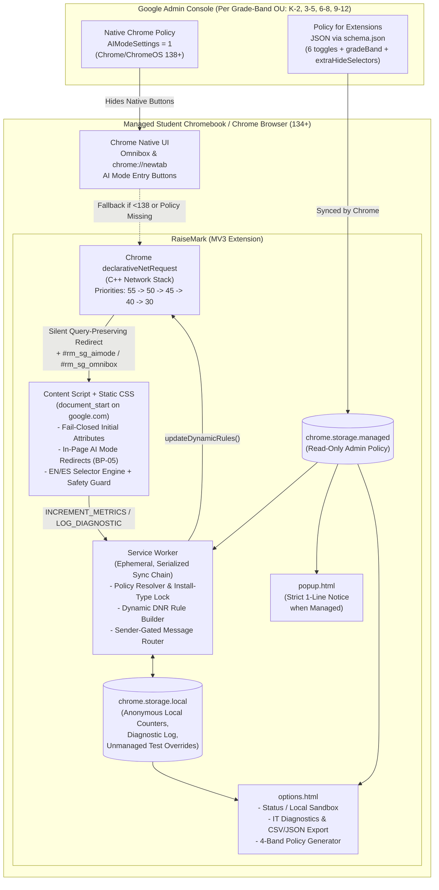
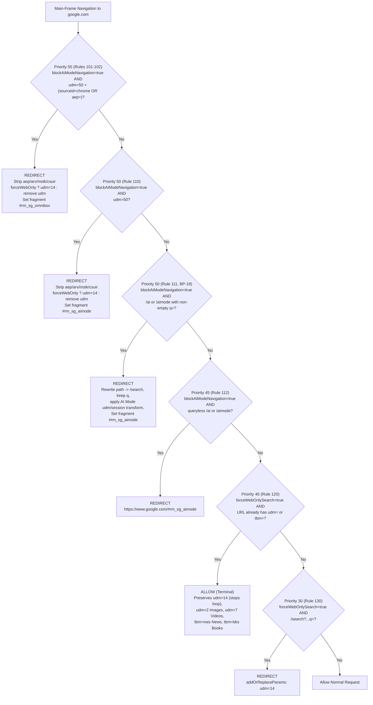
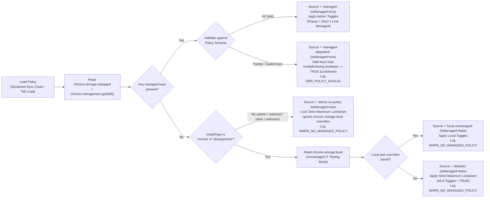

# 02 — System Architecture & Security Design

> **Current Implementation Note (2026-11-21, v1.0.1 — Phases 0–5 Complete):** Per [`docs/07-BREAKPOINT-AUDIT-LOG.md`](07-BREAKPOINT-AUDIT-LOG.md) (decisions D4–D8), the product is titled **RaiseMark: AI Search Controls for K-12**, requires **Chrome / ChromeOS 134+**, and removed the optional District BYOS Analytics subsystem (`script.google.com` / `chrome.alarms`) in Phase 0b (`archive/analytics-v1/`). The diagrams and security invariants below reflect the shipped v1.0.1 architecture (strict `google.com` scope, zero external network requests, `admin-no-policy` fail-closed lock, BP-05 in-page navigation redirect, BP-19 query-preserving `/aimode?q=…`, and `extraHideSelectors`); see [`PRIVACY.md`](../PRIVACY.md).

**Product:** RaiseMark: AI Search Controls for K-12 *(originally drafted as RaiseMark Search Guard for K-12)*  
**Architecture Style:** Hybrid Defense-in-Depth (Chrome Enterprise Native Policy + MV3 Extension Network & DOM Layers)

---

## 1. High-Level Component & Surface Ownership Architecture

Chrome enforces a strict security boundary between **native browser UI** (Omnibox, `chrome://newtab`) and **web origins** (`https://www.google.com/*`). **RaiseMark: AI Search Controls for K-12** resolves this cleanly by uniting Google Admin Console's native `AIModeSettings` policy with the extension's two runtime layers:



*(Note: The optional district Google Sheets / Apps Script analytics sink from the original draft was removed in Phase 0b and archived under `archive/analytics-v1/`.)*

---

## 2. End-to-End Request & DOM Interception Sequence

```mermaid
sequenceDiagram
    autonumber
    participant Student
    participant Chrome as Chrome Omnibox / Network (DNR)
    participant Google as google.com Server
    participant CS as Content Script (document_start)
    participant SW as Service Worker

    Note over Student,SW: Case A: Student clicks Omnibox AI Mode (when AIModeSettings missed) OR visits ?udm=50
    Student->>Chrome: Navigate to google.com/search?q=photosynthesis&udm=50&sourceid=chrome
    Chrome->>Chrome: DNR Priority 55 matches (sourceid=chrome + udm=50)
    Chrome->>Chrome: Strip udm/aep/arv (or set udm=14) + set client fragment #rm_sg_omnibox
    Note right of Chrome: Fragment #rm_sg_omnibox is NEVER sent to Google servers
    Chrome->>Google: GET /search?q=photosynthesis(&udm=14)
    Google-->>CS: HTML Stream Starts (document_start)
    CS->>CS: Read location.hash (#rm_sg_omnibox) & strip via history.replaceState()
    CS->>SW: sendMessage(RECORD_REDIRECT, { source: "omnibox" })
    SW->>SW: Increment aiModeRedirects & omniboxFallbackRedirects + Log WARN_OMNIBOX_POLICY_MISSING

    Note over Student,SW: Case B: Standard Google Search Page Render (Fail-Closed at document_start)
    CS->>CS: Synchronously set html[data-rmsg-hide-*="1"] before policy loads (BP-02)
    CS->>SW: Request content-safe policy (GET_EFFECTIVE_POLICY; fallback locks if unreachable)
    CS->>CS: Remove disabled data-rmsg-hide-* attributes per policy (keep on if masterEnabled)
    Google-->>CS: DOM nodes stream & hydrate asynchronously
    CS->>CS: MutationObserver -> 150 ms throttled rAF sweep -> Tier 1 EN/ES + Tier 2 + extraHideSelectors
    CS->>CS: Organic Safety Guard checks candidate (< 1 organic for overview, < 3 otherwise; restores late-mutated wrappers)
    CS->>CS: Hide matched containers (data-rmsg-hidden="overview|aimode|aux") + run leak detector
    CS->>SW: Flush batched per-page counts (pagehide / hidden / 10 s): INCREMENT_METRICS (at most 1 per category per page)
```

---

## 3. Declarative Net Request (DNR) Priority & Loop-Freedom Architecture

Chrome's `declarativeNetRequest` uses Google's **RE2** regex engine (which intentionally forbids negative lookaheads `(?!...)` to prevent catastrophic backtracking). To guarantee **zero redirect loops** while supporting BOTH `blockAiModeNavigation` and optional `forceWebOnlySearch` (`udm=14`) without breaking Google Images (`udm=2`), Videos (`udm=7`), Shopping (`udm=28`), or News (`tbm=nws`), dynamic rules are structured into **5 strict priority tiers**:



### Formal Loop-Freedom Proof
1. Any redirect emitted by **Priority 55, 50, or 45** removes `udm=50` (replacing it with `udm=14` or removing `udm`) and rewrites `/ai` or `/aimode` to `/search` (Rule 111) or `/` (Rule 112). Therefore, on the redirected request, Rules `101`, `102`, `110`, `111`, and `112` **cannot match again**.
2. If `forceWebOnlySearch === true`, the redirected `/search` request has `udm=14` (or `/search?q=...` gets `udm=14` from Priority 30). On the subsequent load, **Priority 40 (`allow`)** matches `udm=` and terminates rule evaluation before Priority 30.
3. Therefore, every URL converges in **at most 1–2 redirect hops** (2 hops only in the case where an unhandled queryless/subpath variant settles cleanly via Rule 112 → `/` or `q=` → `udm=14`). Zero infinite loops are mathematically possible. (In-page `history.pushState` / `popstate` navigations into AI Mode are mirrored in `src/shared/ai-mode-url.ts` so SPA switches follow the same transform.)

---

## 4. Policy Resolution & Fail-Closed State Machine



### Critical Security Invariant (Anti-Tampering)
When `chrome.storage.managed` contains **any** policy object pushed by Google Admin Console **or** the extension is force-installed (`installType === "admin"`) or its install type cannot be determined (`"unknown"`):
* `chrome.storage.local` toggle overrides are **completely ignored** at runtime, and `SET_LOCAL_OVERRIDES` / `RESET_LOCAL_METRICS` are refused by the service worker (`BP-01`, `BP-07`, `BP-13`).
* `popup.html` renders **strictly** the locked 1-line *"Managed by your school"* view (falling back to locked if the service worker is unreachable).
* `options.html` renders all feature toggles and **"Reset Local Counters"** as `disabled` read-only controls.
* Students have zero mechanism in Chrome UI (when force-installed) or extension UI to weaken protections or wipe local counters.

---

## 5. Local-Only Counters & Zero External Network Traffic (D6)

In Phase 0b (2026-11-20, owner decision D6), the optional Google Sheets / Apps Script district analytics subsystem was removed before release because an MV3 extension cannot hold a client secret and restricting the script to district sign-in would have tied reports to student identities (`archive/analytics-v1/`).

* **Zero external requests:** The extension makes zero `fetch` / `XMLHttpRequest` / beacon calls.
* **Local-only aggregate counters:** `chrome.storage.local` records only aggregate integer counters (`overviewsHidden`, `aiModeUiHidden`, `aiModeRedirects`, `omniboxFallbackRedirects`, `auxAiHidden`) and bounded `ERR_*` / `WARN_*` diagnostic codes with `YYYY-MM-DD` date buckets.
* **Epoch-gated reset hygiene (`BP-09`):** `RESET_LOCAL_METRICS` (unlocked installs only) increments a local reset epoch so unflushed batches from open tabs cannot re-populate cleared totals.

---

## 6. Permission Minimization Matrix

| Manifest Field | Exact Value (`src/manifest.json`) | Why Required (Least-Privilege Justification) |
| :--- | :--- | :--- |
| `minimum_chrome_version` | `"134"` | Covers every active ChromeOS LTS and guarantees baseline API/CSS support (`:has()`, `@layer`, `hidden="until-found"`, Navigation API, `:user-invalid`). |
| `permissions` | `"storage"` | Read Admin Console policies (`chrome.storage.managed`) and store anonymous local counters & diagnostic error logs (`chrome.storage.local`). |
| `permissions` | `"declarativeNetRequestWithHostAccess"` | Dynamically enable/disable silent redirects for `udm=50`, `google.com/ai`, `google.com/aimode`, and optional `udm=14` based on the active grade-band policy. |
| `host_permissions` | `"https://www.google.com/*"`, `"https://google.com/*"` | Required for `declarativeNetRequest` redirects and content-script DOM suppression strictly on U.S. Google Search. |
| **Removed in Phase 0b (D6)** | `alarms`, `https://script.google.com/*`, `https://script.googleusercontent.com/*` | Removed when district Google Sheets analytics was dropped; zero background alarms or external hosts remain. |
| **Explicitly Omitted** | `tabs`, `webRequest`, `webNavigation`, `identity`, `cookies`, `history`, `scripting`, `management`, `<all_urls>` | **Not needed.** Fragment handoff (`#rm_sg_*`), `chrome.management.getSelf()` (no permission required), content scripts, and `storage.managed` eliminate every sensitive permission. |
