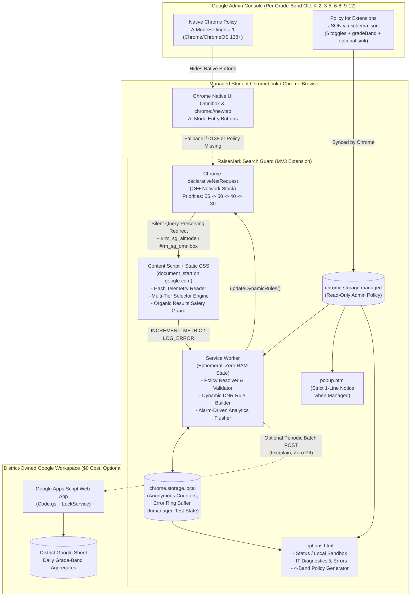
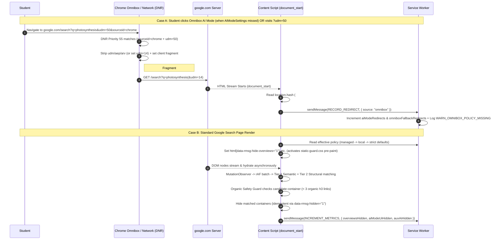
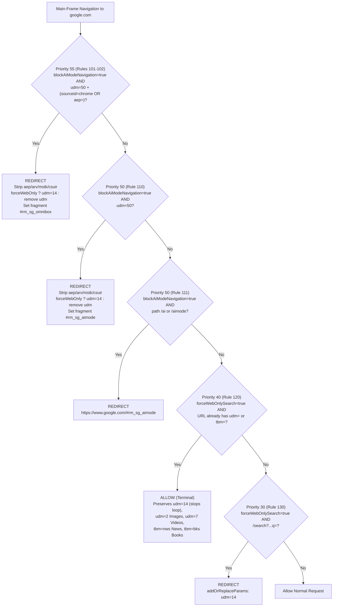
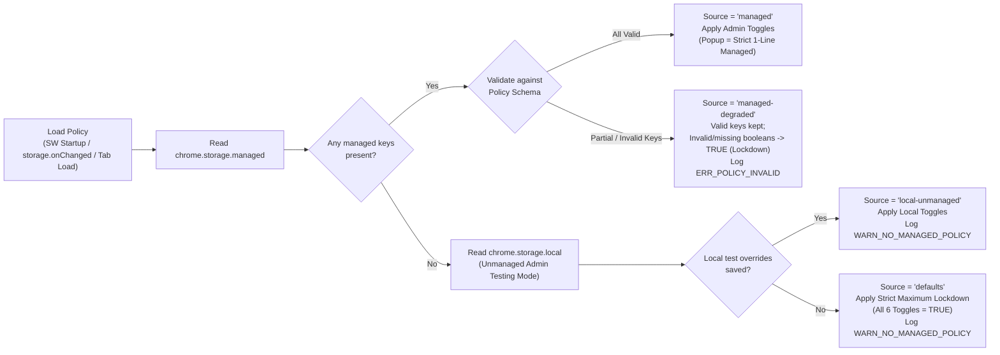
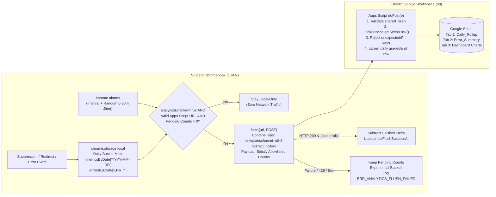

# 02 — System Architecture & Security Design

**Product:** RaiseMark Search Guard for K-12  
**Architecture Style:** Hybrid Defense-in-Depth (Chrome Enterprise Native Policy + MV3 Extension Network & DOM Layers + Zero-PII District BYOS Analytics)

---

## 1. High-Level Component & Surface Ownership Architecture

Chrome enforces a strict security boundary between **native browser UI** (Omnibox, `chrome://newtab`) and **web origins** (`https://www.google.com/*`). RaiseMark Search Guard resolves this cleanly by uniting Google Admin Console's native `AIModeSettings` policy with the extension's two runtime layers:

---

## 2. End-to-End Request & DOM Interception Sequence

---

## 3. Declarative Net Request (DNR) Priority & Loop-Freedom Architecture

Chrome's `declarativeNetRequest` uses Google's **RE2** regex engine (which intentionally forbids negative lookaheads `(?!...)` to prevent catastrophic backtracking). To guarantee **zero redirect loops** while supporting BOTH `blockAiModeNavigation` and optional `forceWebOnlySearch` (`udm=14`) without breaking Google Images (`udm=2`), Videos (`udm=7`), Shopping (`udm=28`), or News (`tbm=nws`), dynamic rules are structured into **4 strict priority tiers**:

### Formal Loop-Freedom Proof
1. Any redirect emitted by **Priority 55 or 50** removes `udm=50` (either removing `udm` completely or replacing it with `udm=14`). Therefore, on the redirected request, Rules `101`, `102`, `110`, and `111` **cannot match again**.
2. If `forceWebOnlySearch === true`, the redirected request has `udm=14` (or `/search?q=...` gets `udm=14` from Priority 30). On the subsequent load, **Priority 40 (`allow`)** matches `udm=` and terminates rule evaluation before Priority 30.
3. Therefore, every URL converges in **at most 1 redirect hop** (2 hops only in the theoretical edge case where an admin enables `blockAiModeNavigation=true`, `forceWebOnlySearch=false`, and the user visits `/ai` -> `/` which doesn't match `/search`). Zero infinite loops are mathematically possible.

---

## 4. Policy Resolution & Fail-Closed State Machine

### Critical Security Invariant (Anti-Tampering)
When `chrome.storage.managed` contains **any** policy object pushed by Google Admin Console:
* `chrome.storage.local` toggle overrides are **completely ignored** at runtime.
* `popup.html` renders **strictly** the locked 1-line *"Managed by your school"* view.
* `options.html` renders all feature toggles as `disabled` read-only indicators.
* Students have zero mechanism in Chrome UI (when force-installed) or extension UI to weaken protections.

---

## 5. Zero-PII, Zero-Cost District Analytics Data Flow

### Privacy & Thundering-Herd Safeguards
1. **Strict Payload Schema Whitelist:** No student email, no username, no browser fingerprint, no device ID, no IP stored in Sheets, no search query strings, no exact event timestamps—only `dateBucket` (`YYYY-MM-DD`), `gradeBand`, `extensionVersion`, and integer counters.
2. **Endpoint Allowlist Regex:** Service worker refuses to POST to any URL that does not strictly match `^https://script\.google\.com/macros/s/[A-Za-z0-9_-]+/exec$`, logging `ERR_ANALYTICS_ENDPOINT_INVALID`.
3. **Thundering-Herd Protection:** A 10,000-Chromebook district booting at 8:00 AM would overwhelm Apps Script's ~30 concurrent execution ceiling if synced simultaneously. Our scheduler adds **uniform random jitter (0–30 minutes)** on every alarm cycle, caps retries with exponential backoff (up to 24h), and uses `LockService.getScriptLock().waitLock(15000)` in `Code.gs`.
4. **Atomic Delta Accounting:** When flushing, the service worker snapshots the pending counters (`snapshot`), sends `snapshot`, and upon HTTP 200 subtracts `snapshot` from current `chrome.storage.local` totals (never blindly zeroing, so events occurring during the HTTP round-trip are never lost!).

---

## 6. Permission Minimization Matrix

| Manifest Field | Exact Value | Why Required (Least-Privilege Justification) |
| :--- | :--- | :--- |
| `permissions` | `"storage"` | Read Admin Console policies (`chrome.storage.managed`) and store anonymous local counters & diagnostic error logs (`chrome.storage.local`). |
| `permissions` | `"declarativeNetRequestWithHostAccess"` | Dynamically enable/disable silent redirects for `udm=50`, `google.com/ai`, and optional `udm=14` based on the active grade-band policy. |
| `permissions` | `"alarms"` | Schedule jittered periodic background flushes to the optional district-owned Google Apps Script webhook without violating MV3 ephemeral service worker rules. |
| `host_permissions` | `"https://www.google.com/*"`, `"https://google.com/*"` | Required for `declarativeNetRequest` redirects and content-script DOM suppression strictly on U.S. Google Search. |
| `host_permissions` | `"https://script.google.com/*"`, `"https://script.googleusercontent.com/*"` | Required ONLY to allow background service-worker POSTs (and 302 redirects) when a district administrator explicitly configures an Apps Script analytics webhook URL in managed policy. Never contacted unless configured. |
| **Explicitly Omitted** | `tabs`, `webRequest`, `webNavigation`, `identity`, `cookies`, `history`, `scripting`, `<all_urls>` | **Not needed.** Fragment handoff (`#rm_sg_*`) + content scripts + `storage.managed` eliminate every sensitive permission. |
