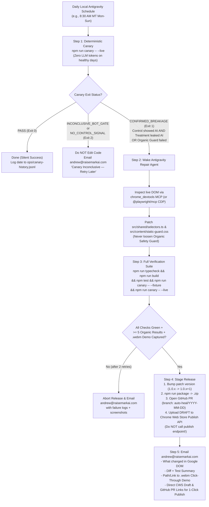

# 05 — Phase 2 Operations Spec: Daily Selector Watchdog & Self-Healing Pipeline

> **Current Implementation Note (2026-11-21):** This document is a future post-release operations concept. Current active engineering work, breakpoint fixes (`BP-01`–`BP-19`), and verification suites (`S`, `U`, `B`, `L`, `M`, `O`, `R`) are tracked in [`docs/07-BREAKPOINT-AUDIT-LOG.md`](07-BREAKPOINT-AUDIT-LOG.md).

**Status:** Post-Release Operations Concept (builds on the `src/` + `tests/` harness in `docs/07-BREAKPOINT-AUDIT-LOG.md`)  
**Maintainer Notification Target:** `info@raisemarkai.com`  
**Hosting Cost:** \$0.00/month (runs via local Antigravity `/schedule` automation + free Chrome Web Store Publish API + free GitHub PRs)

---

## 1. Architectural Goal & Why Local Daytime Antigravity Wins

School districts must have **zero maintenance burden** when Google changes Search DOM structure or URL parameters. At the same time, running daily Google Search scrapes from cloud datacenter IPs (GitHub Actions / Cloud Run) routinely hits Google's anti-bot / "unusual traffic" gates, causing chronic false failures.

Phase 2 solves both constraints with a **Local Daytime Antigravity Scheduled Watchdog + Human 1-Click CWS Draft Gate**:

---

## 2. Deterministic Canary Exit Contract (`scripts/canary.ts --live`)

The Phase 1 `scripts/canary.ts` script MUST emit a deterministic JSON report (`artifacts/canary-report.json`) and exact process exit codes so Phase 2 automation never misinterprets an inconclusive run as a broken extension:

| Exit Code | Report `status` | Meaning | Phase 2 Action |
| :--- | :--- | :--- | :--- |
| `0` | `PASS` | Control confirmed AI surface existed AND Treatment suppressed it, DNR redirects succeeded, AND Organic Guard verified `>= 5` visible organic `<h3>` results. | Record green check; stop (0 LLM repair tokens spent). |
| `1` | `CONFIRMED_BREAKAGE` | Control confirmed AI surface rendered AND Treatment failed to hide/redirect it, OR Treatment hid organic search results (`< 5` organic `<h3>` results), OR `udm=50` / `google.com/ai` failed to redirect. | Trigger Antigravity Repair Workflow. |
| `2` | `INCONCLUSIVE_BOT_GATE` | Google returned `/sorry/`, CAPTCHA, or unusual-traffic block page. **Never attempt to solve or bypass.** | Abort cleanly; email brief notice to `andrew@raisemarkai.com`. |
| `2` | `INCONCLUSIVE_NO_CONTROL_SIGNAL` | Google A/B test showed zero AI Overviews and zero AI Mode UI in the Control (extension-OFF) session across all canonical queries. | Abort cleanly without modifying code; re-check next cycle. |

---

## 3. Antigravity Repair Agent Guardrails

When triggered on Exit Code `1`, the Antigravity repair workflow follows strict safety invariants:
1. **Allowed Files to Modify:** Strictly `src/shared/selectors.ts`, `src/content/static-guard.css`, `src/background/dnr-rules.ts` (if Google changes `udm=50` / `/ai` URL params), `tests/*.test.ts`, `package.json` / `src/manifest.json` (patch version bump only), and `CHROMEWEBSTORE.md` (Version History row).
2. **Forbidden Changes:**
   * NEVER add new permissions or `host_permissions` to `manifest.json`.
   * NEVER weaken `isUnsafeToHide()` (the Organic Results Safety Guard) in `src/content/dom-engine.ts`.
   * NEVER introduce `eval()`, remote config fetches, or third-party scripts.
   * NEVER attempt to solve or bypass any CAPTCHA/anti-bot page.
3. **Interactive DOM Inspection Tools:**
   * Primary: Existing **`chrome_devtools` MCP** (`new_page`, `navigate_page`, `take_snapshot`, `evaluate_script`, `screencast_start`/`screencast_stop`).
   * Optional Secondary: Free **`@playwright/mcp`** attached via `--cdp-endpoint=http://localhost:9222` to a Chrome instance launched with `--load-extension=./dist`.
4. **Mandatory Verification Before Staging:**
   * `npm run typecheck` (0 errors)
   * `npm run build` (0 errors + valid PNG icons)
   * `npm test` (100% pass, including a new unit test reproducing the newly observed Google DOM snippet!)
   * `npm run canary -- --fixture` (Exit 0)
   * `npm run canary -- --live` (Exit 0 + `.webm` click-through demo proving AI Overview hidden, AI Mode hidden, `?udm=50` redirected, Images `udm=2` working, and `>= 5` organic results visible)

---

## 4. Chrome Web Store Draft Upload & Email Notification Gate

### 4.1 Chrome Web Store Publish API (Draft-Only Upload)
* Uses Google's free **Chrome Web Store API** (`https://www.googleapis.com/upload/chromewebstore/v1.1/items/{itemId}` — `PUT` with the built `release/raisemark-ai-search-controls-v<version>.zip`).
* **CRITICAL SAFETY RULE:** Phase 2 uploads the new package as a **DRAFT ONLY** and deliberately **does NOT** invoke the `/publish` endpoint automatically.
* **Graceful Auth-Expiry Fallback:** If the CWS OAuth refresh token has expired or returns `401/403`, Phase 2 STILL opens the GitHub PR with the tested diff + local `.zip` path + `.webm` video and includes `"CWS Draft upload skipped — refresh OAuth token"` in the email to `andrew@raisemarkai.com`.

### 4.2 Maintainer Email Format (`andrew@raisemarkai.com`)
Dispatched via `raisemark-google` Gmail integration (or Gmail draft/send per user preference configured when activating Phase 2):
* **Subject:** `[RaiseMark Watchdog] Action Needed: Selector Update v1.0.X Ready for 1-Click Publish`
* **Body:**
  * **Detected Change:** Exact failing check from `canary-report.json` (e.g., AI Overview wrapper attribute rotated).
  * **Patch Summary:** Concise diff of `selectors.ts` / `static-guard.css` + new unit test added.
  * **Verification Proof:** Pass counts for `typecheck`, `vitest`, `canary --fixture`, `canary --live` (including organic link count preserved) + path/link to click-through `.webm` demo video.
  * **Next Step (1-Click Approve):** Links to the GitHub PR and Chrome Web Store Developer Dashboard Draft item.

---

## 5. Activating Phase 2 (Post-MVP Setup Checklist)

Once Phase 1 MVP is built and first published to the Chrome Web Store:
1. Record the assigned Chrome Web Store `EXTENSION_ID`.
2. Create an OAuth client with `https://www.googleapis.com/auth/chromewebstore` scope and store credentials securely in local keychain / `.env.ops` (gitignored — NEVER committed!).
3. Run `/schedule` in Antigravity to register a recurring daytime job (e.g., `30 8 * * *` local time) pointing at the workspace's repair prompt.
4. Confirm first dry-run executes `npm run canary -- --live` cleanly and logs `PASS` to `ops/canary-history.jsonl`.
